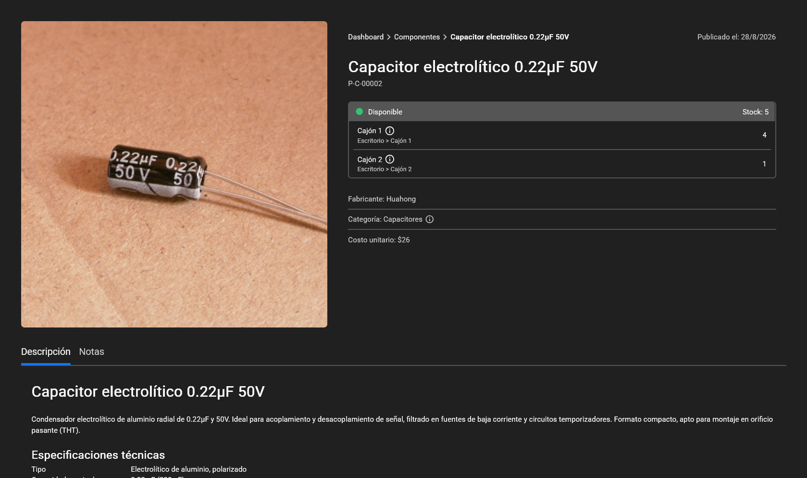
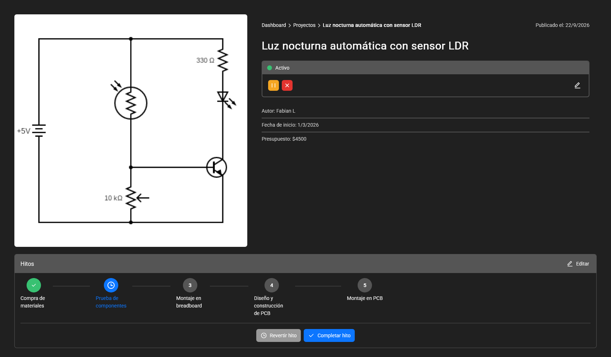
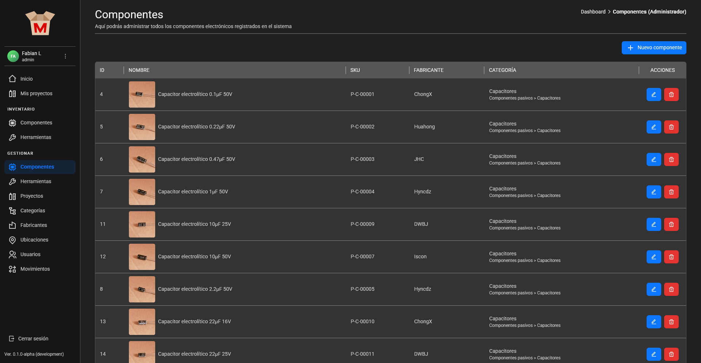
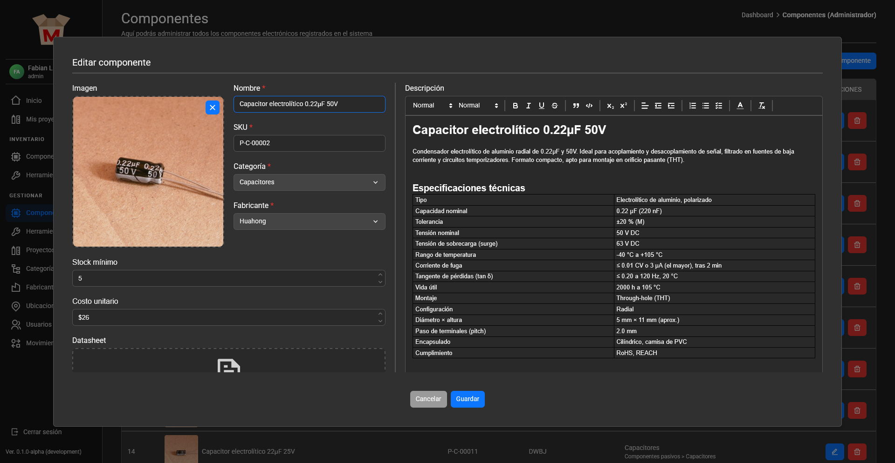

# Makerbox

## Introducción


Makerbox es un IMS (Inventory Management System) para componentes electrónicos y proyectos de electronica. Cuenta con autenticación basada en Tokens (JWT) y control de acceso basado en roles. 

## Tabla de contenidos
1. [Funcionalidades](#funcionalidades)
2. [Roles](#roles)
3. [Tecnologías principales](#tecnologías-principales)
4. [Comandos de desarrollo y pruebas](#comandos-de-desarrollo-y-pruebas)
5. [Despliegue de la aplicación (Local)](#despliegue-de-la-aplicación-local)
6. [Despliegue de la aplicación (Docker)](#despliegue-de-la-aplicación-docker)
8. [Variables de entorno](#variables-de-entorno)
9. [Documentación de la API](#documentación-de-la-api)

## Funcionalidades

### Gestión de inventario de componentes electrónicos y herramientas
Con Makerbox podrás registrar componentes electrónicos y herramientas que cuentan con diversas características como: 
* Imágenes
* Ubicaciones en las que se encuentran los componentes o herramientas con su respectivo stock (solo componentes)
* Descripciones con texto enriquecido
* Datasheet (componentes) o manuales (herramientas)
* Y más



### Gestión de proyectos
También podrás gestionar proyectos de electronica que cuentan con características como: 
* Presupuesto
* Estado (En planificación, en desarrollo, completado, pausado y cancelado)
* Hitos
* Lista de componentes requeridos (WIP)
* Y más



### Sección de administradores
El sistema cuenta con una sección para administrar todos los recursos registrados en el sistema, desde componentes hasta usuarios.





## Roles
* Administrador: Este rol permite el acceso a todas las funciones de la aplicación. Puede gestionar el inventario de componentes electrónicos, crear y gestionar proyectos, y administrar usuarios y roles.
* Técnico: Este rol permite el acceso al inventario y a la creación y gestión de proyectos. No tiene permisos para administrar usuarios ni roles.
* Lector: Este rol solo permite el acceso al inventario (Rol de tipo guest).

## Tecnologías principales

### Frontend
* React: Creación de la interfaz de usuario.
* TanStack Router: Navegación y gestión de rutas.
* TanStack Query: Consultas y sincronización de datos con el backend.
* React Aria: Componentes de UI.
* Tailwind: Estilos de la aplicación.
* Axios: Comunicación HTTP con el backend.
* Quill: Edición de texto enriquecido.

### Backend
* express: Servidor y API REST.
* postgres: Conexión y consultas a PostgreSQL.
* jsonwebtoken: Autenticación basada en tokens.
* bcrypt: Hash de contraseñas.
* Helmet: Cabeceras de seguridad.
* Valibot: Validación de datos.
* Scalar: Documentación de la API.

### Base de datos
* PostgreSQL 18

### Pruebas y desarrollo
* TypeScript: tipado estático en frontend y backend.
* Vite: servidor de desarrollo y compilación del frontend.
* Jest y Supertest: pruebas unitarias y de integración del backend.
* Docker Compose: despliegue local de los servicios.


## Comandos de desarrollo y pruebas

| Acción | Comando | Notas |
|--|--|--|
| Ejecutar frontend en modo desarrollo | `pnpm dev:frontend` |
| Ejecutar backend en modo desarrollo | `pnpm dev:backend` |
| Ejecutar frontend y backend en modo desarrollo | `pnpm dev:all` |
| Realizar pruebas unitarias y de integración del backend | `pnpm test:backend` | Antes de ejecutar las pruebas, se debe copiar el .env.test.example a env.test y agregar los valores deseados.|
| Comprobación de errores de tipo | `pnpm type-check:backend` |
| Compilación del frontend | `pnpm build:frontend` |
| Compilación del backend | `pnpm build:backend` |
| Compilación del frontend y backend | `pnpm build:all` |

## Despliegue de la aplicación (Local)

### Requerimientos
* Node.js 24.18.0
* PostgreSQL 18
* Pnpm 11.3.0

### Pasos para el despliegue local
1. Clonar el repositorio.
2. En la carpeta raíz ejecutar `pnpm install` para instalar las dependencias.
3. Crear la base de datos en PostgreSQL y utilizar `apps/backend/Makerbox.sql` para crear las tablas necesarias.
4. Copiar `.env.example` a `.env` en:
	* `apps/backend`
	* `apps/frontend`
	
	y agregar los valores de las variables de entorno con los valores deseados (Ver [Variables de entorno](#variables-de-entorno) para más información).
5. Iniciar el backend y frontend con `pnpm dev:all`.
6. Abrir `http://localhost:5173`.
7. Iniciar sesión con el usuario administrador (por defecto: correo: `admin@test.com`, contraseña: `adminPass`).
	> Importante: Este usuario es solo para acceder al sistema por primera vez, por motivos de seguridad se recomienda crear un nuevo usuario administrador, iniciar sesión con el usuario creado y eliminar el usuario por defecto.

## Despliegue de la aplicación (Docker)

### Requerimientos
* Docker engine
* Docker Compose

### Pasos para el despliegue con Docker
1. Clonar el repositorio.
2. Copiar cada `.env.example` a `.env` en:
	* Carpeta raíz
	* `apps/backend` (En la variable `DB_HOST` usar `db` que es el nombre del servicio de postgres en `docker-compose.yml`)
	* `apps/frontend`

	Y reemplazar los valores de las variables de entorno con los valores deseados (Ver [Variables de entorno](#variables-de-entorno) para más información).
3. En la carpeta raíz ejecutar
	```sh
	docker compose up --build -d
	```
 	para construir y desplegar la aplicación.
4. Abrir `http://localhost:8080` (o el puerto configurado por `APP_PORT` en el `.env` de la carpeta raíz).
5. Iniciar sesión con el usuario administrador (por defecto: correo: `admin@test.com`, contraseña: `adminPass`).
	> Importante: Este usuario es solo para acceder al sistema por primera vez, por motivos de seguridad se recomienda crear un nuevo usuario administrador, iniciar sesión con el usuario creado y eliminar el usuario por defecto.

## Variables de entorno

### Backend
| Variable | Descripción |
|--|--|
| BACK_APP_PORT | Puerto del backend |
| BACK_APP_URL | Dominio del backend |
| FRONT_APP_URL | Puerto del frontend |
| FRONT_APP_URL | Dominio del frontend |
| DB_HOST | Dominio de la base de datos |
| DB_PORT | Puerto de la base de datos |
| DB_NAME | Nombre de la base de datos |
| DB_USER | Nombre del usuario de la base de datos |
| DB_PASSWORD | Contraseña del usuario de la base de datos |
| JWT_SECRET | Secret para firmar JWT's |

### Frontend
| Variable | Descripción |
|--|--|
| VITE_APP_VERSION | Versión de la aplicación |
| VITE_BACKEND_URL | URL del backend |

### Docker (En carpeta raíz)
| Variable | Descripción |
|--|--|
| POSTGRES_DB | Nombre de la base de datos |
| POSTGRES_USER | Nombre del usuario de la base de datos |
| POSTGRES_PASSWORD | Contraseña del usuario de la base de datos |
| APP_PORT | Puerto del frontend a exponer |

## Documentación de la API

La documentación de la API se encuentra en el backend en `/docs` (Por ejemplo, en un despliegue local sería: `http://localhost:3000/docs`)
